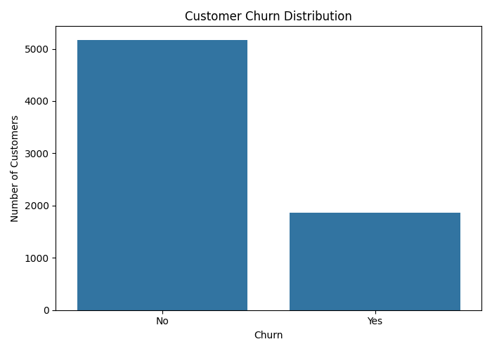
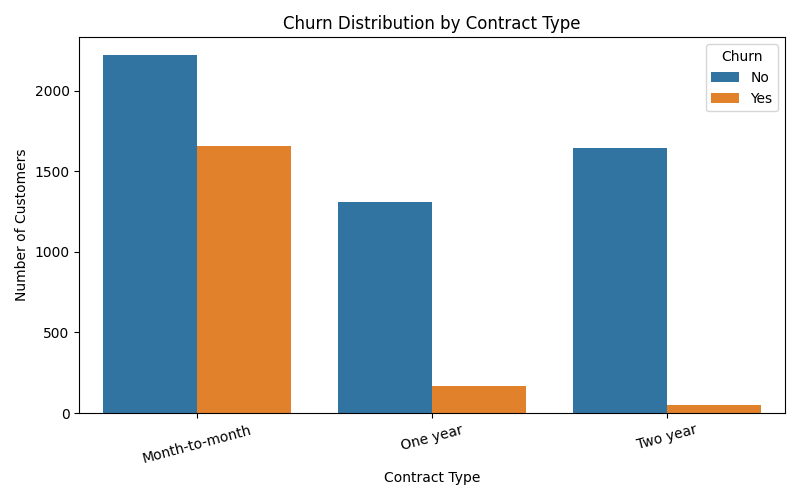
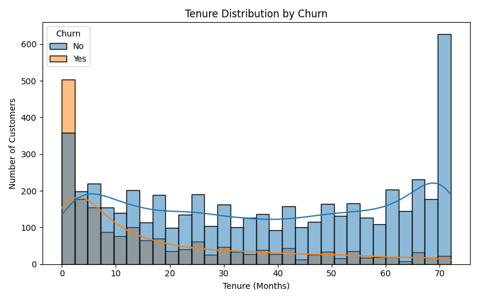
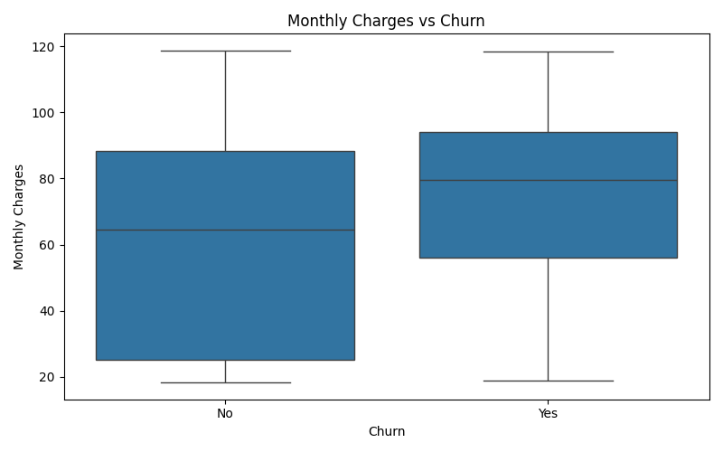
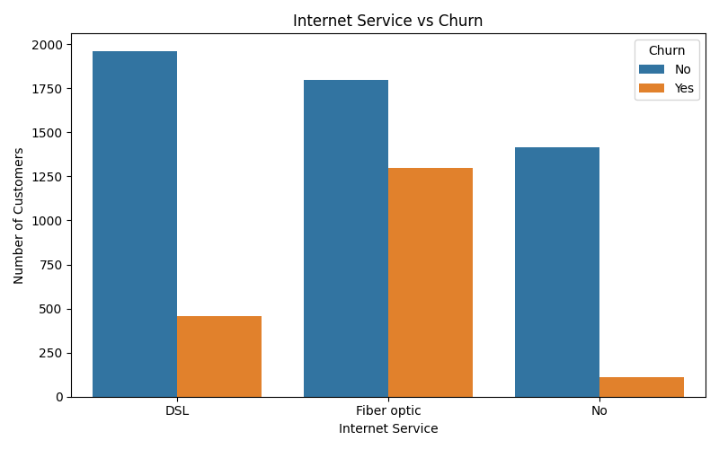
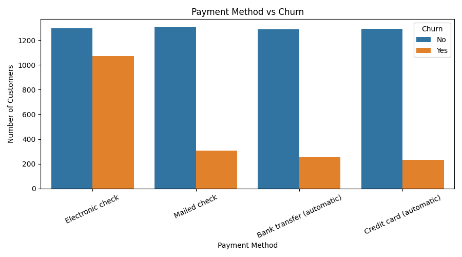
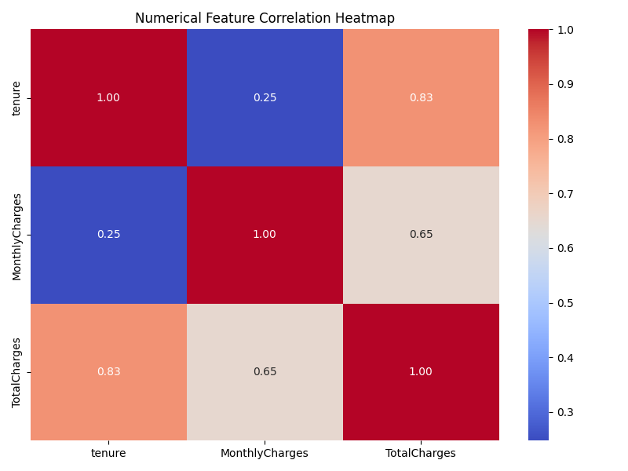
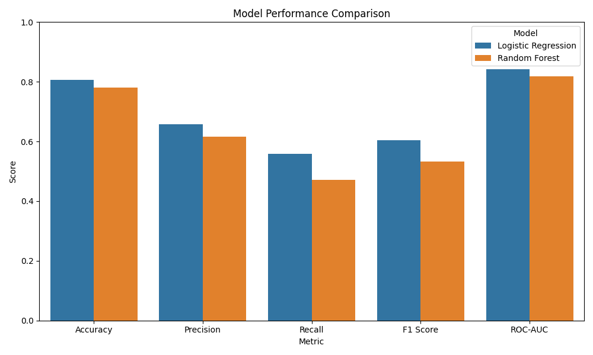
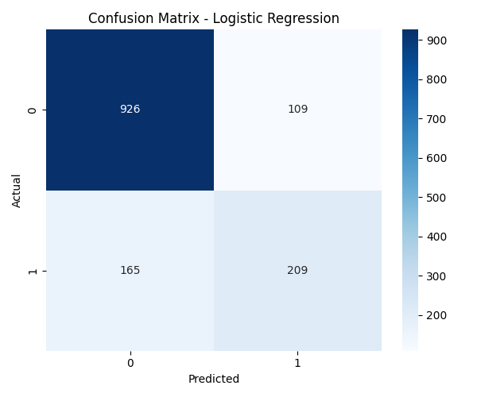
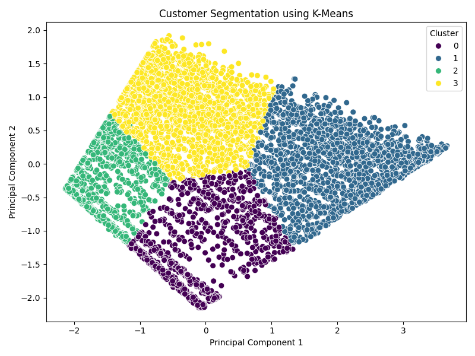

# Telecom Customer Churn Prediction and Customer Segmentation

## 📌 Project Overview

This project is an end-to-end Data Science capstone project focused on analyzing telecom customer behavior, predicting customer churn, and segmenting customers into different groups.

Customer churn is a major challenge in the telecom industry because losing existing customers can affect revenue and long-term business growth. The objective of this project is to use data analysis and machine learning techniques to understand customer behavior, identify customers who are likely to churn, and discover meaningful customer segments.

The project follows a complete Data Science pipeline:

**Data Collection → Data Cleaning → Exploratory Data Analysis → Data Preprocessing → Supervised Machine Learning → Model Evaluation → Customer Segmentation → Insights → Recommendations**

---

## 🎯 Objectives

The main objectives of this project are:

* Analyze telecom customer data.
* Identify important factors related to customer churn.
* Clean and preprocess the dataset.
* Perform Exploratory Data Analysis (EDA).
* Build machine learning models for churn prediction.
* Compare Logistic Regression and Random Forest models.
* Evaluate models using Accuracy, Precision, Recall, F1-Score and ROC-AUC.
* Perform customer segmentation using K-Means clustering.
* Generate business insights and recommendations.
* Build a complete and reproducible Data Science pipeline using Python.

---

## 📊 Dataset

The project uses the **IBM Telco Customer Churn Dataset**, which contains information about telecom customers and their service usage.

### Dataset Information

* **Number of records:** 7,043
* **Number of columns:** 21
* **Target variable:** Churn
* **Customer identifier:** customerID

### Important Features

| Feature           | Description                                        |
| ----------------- | -------------------------------------------------- |
| `gender`          | Customer gender                                    |
| `SeniorCitizen`   | Indicates whether the customer is a senior citizen |
| `Partner`         | Whether the customer has a partner                 |
| `Dependents`      | Whether the customer has dependents                |
| `tenure`          | Number of months the customer has stayed           |
| `PhoneService`    | Whether phone service is subscribed                |
| `InternetService` | Type of internet service                           |
| `OnlineSecurity`  | Online security subscription                       |
| `OnlineBackup`    | Online backup subscription                         |
| `TechSupport`     | Technical support subscription                     |
| `Contract`        | Customer contract type                             |
| `PaymentMethod`   | Customer payment method                            |
| `MonthlyCharges`  | Monthly customer charges                           |
| `TotalCharges`    | Total charges                                      |
| `Churn`           | Whether the customer left the company              |

---

# 🔄 Data Science Pipeline

```text
        Dataset
           ↓
    Data Collection
           ↓
      Data Cleaning
           ↓
         EDA
           ↓
   Data Preprocessing
           ↓
   ┌───────────────┐
   ↓               ↓
Supervised       Unsupervised
Learning         Learning
   ↓               ↓
Churn Prediction  Customer Segmentation
   ↓               ↓
Model Evaluation  K-Means Clustering
   ↓               ↓
       Insights & Recommendations
                 ↓
             Conclusion
```

---

# 🧹 1. Data Cleaning

The dataset was inspected for missing values, duplicate records and incorrect data types.

### Cleaning steps performed:

* Converted `TotalCharges` from object type to numeric.
* Invalid or blank values in `TotalCharges` were converted to missing values.
* Missing `TotalCharges` values were replaced using the median.
* `customerID` was removed because it is only an identifier and does not contribute to prediction.
* `SeniorCitizen` values were converted into meaningful categorical values.
* Duplicate records were checked.
* Numerical and categorical features were separated for machine learning preprocessing.

The cleaned dataset was saved as:

```text
outputs/cleaned_telco_customer_churn.csv
```

---

# 📈 2. Exploratory Data Analysis

EDA was performed to understand customer behavior and identify patterns related to churn.

## Churn Distribution

This visualization shows the distribution of customers who stayed with the company and customers who churned.



---

## Contract Type vs Churn

This visualization analyzes the relationship between contract type and customer churn.



---

## Tenure vs Churn

Customer tenure was analyzed to understand whether the length of the customer relationship is associated with churn.



---

## Monthly Charges vs Churn

This visualization compares monthly charges between customers who stayed and customers who churned.



---

## Internet Service vs Churn

This analysis shows the relationship between internet service type and customer churn.



---

## Payment Method vs Churn

Different payment methods were compared to identify possible relationships with customer churn.



---

## Correlation Heatmap

The correlation heatmap shows relationships between numerical variables in the dataset.



---

# 🤖 3. Machine Learning

Two supervised machine learning algorithms were implemented for customer churn prediction.

### Models Used

1. Logistic Regression
2. Random Forest Classifier

The dataset was divided into:

* **80% Training Data**
* **20% Testing Data**

Categorical variables were encoded using One-Hot Encoding, while numerical variables were standardized using StandardScaler.

A preprocessing pipeline was created using Scikit-learn's `ColumnTransformer` and `Pipeline`.

---

# 📊 4. Model Evaluation

The models were evaluated using multiple performance metrics:

* Accuracy
* Precision
* Recall
* F1-Score
* ROC-AUC

F1-Score was given importance because churn prediction involves balancing Precision and Recall.

The model comparison results were saved in:

```text
outputs/model_comparison.csv
```

## Model Comparison



The model with the better overall F1-Score was selected as the preferred churn prediction model.

---

# 📉 5. Confusion Matrix

The confusion matrix was generated for the selected best-performing model.

It shows:

* True Positives
* True Negatives
* False Positives
* False Negatives



This helps in understanding how effectively the model identifies customers who are likely to churn.

---

# 👥 6. Customer Segmentation

In addition to churn prediction, unsupervised learning was performed to identify groups of customers with similar characteristics.

### Algorithm Used

**K-Means Clustering**

The following numerical features were used:

* Tenure
* Monthly Charges
* Total Charges

The customer data was standardized before clustering.

Four customer segments were generated using K-Means clustering.

The segmented customer data was saved as:

```text
outputs/customer_segments.csv
```

---

## Customer Cluster Visualization

PCA was used to reduce the dimensions and visualize the customer clusters.



The cluster summary was saved as:

```text
outputs/cluster_summary.csv
```

---

# 💡 7. Key Insights

The analysis provides several useful insights into telecom customer behavior:

* Customer churn is not evenly distributed across all customers.
* Contract type can have an important relationship with customer retention.
* Customer tenure provides useful information for understanding churn behavior.
* Monthly charges can help identify customers who may have a higher likelihood of leaving.
* Internet service type can show differences in churn behavior.
* Payment method can also provide useful information about customer retention.
* Customer segmentation helps the company understand different customer groups instead of treating every customer in the same way.
* Machine learning can support early identification of customers who may be at risk of churn.

---

# 🏢 8. Business Recommendations

Based on the analysis, the following recommendations can be made:

### 1. Focus on High-Risk Customers

Customers identified by the churn prediction model as high-risk can be targeted with retention strategies.

### 2. Improve Customer Retention

The company can provide discounts, loyalty benefits and personalized offers to customers who show signs of potential churn.

### 3. Target Customers Based on Segments

Different customer segments can receive different marketing strategies instead of using one strategy for all customers.

### 4. Monitor New Customers

Customers with shorter tenure can be monitored carefully because early customer experience can influence long-term retention.

### 5. Provide Personalized Services

Service plans and additional support can be recommended based on customer characteristics and usage patterns.

### 6. Use Data-Driven Decision Making

The developed machine learning pipeline can help telecom companies use customer data to support proactive retention decisions.

---

# 🛠️ Technologies Used

* Python
* Pandas
* NumPy
* Matplotlib
* Seaborn
* Scikit-learn
* Logistic Regression
* Random Forest
* K-Means Clustering
* PCA
* Jupyter / VS Code

---

# 📁 Project Structure

```text
Week6_Telecom_Capstone/
│
├── Telco-Customer-Churn.csv
├── telecom_capstone.py
│
├── outputs/
│   ├── cleaned_telco_customer_churn.csv
│   ├── model_comparison.csv
│   ├── customer_segments.csv
│   ├── cluster_summary.csv
│   │
│   └── graphs/
│       ├── churn_distribution.png
│       ├── contract_vs_churn.png
│       ├── tenure_vs_churn.png
│       ├── monthly_charges_vs_churn.png
│       ├── internet_service_vs_churn.png
│       ├── payment_method_vs_churn.png
│       ├── correlation_heatmap.png
│       ├── model_comparison.png
│       ├── confusion_matrix.png
│       └── customer_clusters.png
│
└── README.md
```

---

# ▶️ How to Run the Project

### Step 1: Clone or download the project

Place the project files in a local folder.

### Step 2: Install required libraries

```bash
pip install pandas numpy matplotlib seaborn scikit-learn
```

### Step 3: Make sure the dataset is present

The following file should be inside the project folder:

```text
Telco-Customer-Churn.csv
```

### Step 4: Run the Python program

```bash
python telecom_capstone.py
```

### Step 5: Check the output

After successful execution, the generated CSV files and visualizations will be available inside:

```text
outputs/
```

---

# 📌 Project Outputs

The project generates:

### Data Outputs

* Cleaned telecom dataset
* Model comparison results
* Customer segmentation dataset
* Cluster summary

### Visualization Outputs

* Churn distribution
* Contract vs churn
* Tenure vs churn
* Monthly charges vs churn
* Internet service vs churn
* Payment method vs churn
* Correlation heatmap
* Model comparison
* Confusion matrix
* Customer cluster visualization

---

# 🔮 Future Enhancements

The project can be improved further by:

* Testing additional machine learning algorithms.
* Performing hyperparameter tuning.
* Using advanced ensemble models.
* Creating an interactive Power BI or Streamlit dashboard.
* Adding ROC and Precision-Recall curves.
* Performing advanced feature importance analysis.
* Using more customer behavior features for segmentation.
* Deploying the churn prediction model as a web application.
* Creating an automated customer retention recommendation system.

---

# ✅ Conclusion

This project successfully implemented a complete end-to-end Data Science pipeline for telecom customer churn prediction and customer segmentation.

The project started with raw telecom customer data and progressed through data cleaning, exploratory data analysis, preprocessing, supervised machine learning and unsupervised learning. Logistic Regression and Random Forest were used to predict customer churn, while K-Means clustering was used to identify different customer segments.

The model evaluation using Accuracy, Precision, Recall, F1-Score and ROC-AUC provided a systematic way to compare the predictive models. Customer segmentation further enhanced the analysis by identifying groups of customers with similar characteristics.

Overall, the project demonstrates how Python-based Data Science and Machine Learning techniques can be applied to a real-world telecom business problem. The resulting insights can help telecom companies identify customers at risk of churn, design targeted retention strategies, understand customer groups and make more data-driven business decisions.

The project therefore combines **data preprocessing, EDA, supervised learning, unsupervised learning, model evaluation and business insights** into one complete practical Data Science solution.
